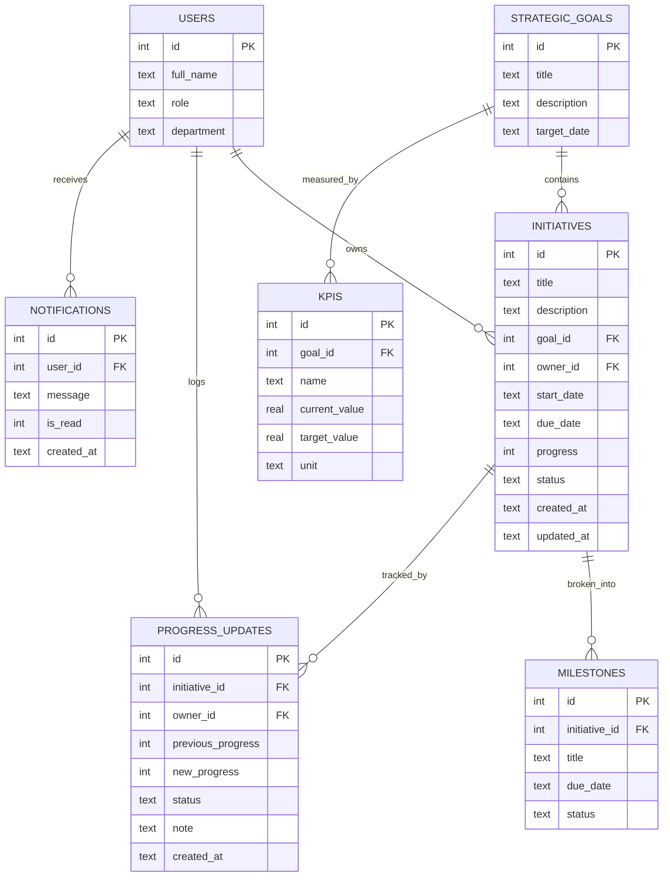

# Prototype Architecture and SRS Traceability — Team T097

> **Course:** CS314 · Software Development Laboratory  
> **Milestone:** Midway Prototype Implementation  
> **System:** Strategic Plan Monitoring Dashboard  
> **SRS Compliance Baseline:** T097 Software Requirements Specification

---

## 1. Selected Implementation Technologies & Justification

The SRS requires a **web-based application** with a **centralized database** supporting role-based operational and managerial workflows. It establishes component responsibilities but does not mandate a specific vendor stack. 

This prototype implements the system using the following stack:

| Layer | Selected Technology | Architectural Justification |
|---|---|---|
| **Frontend UI** | **React 19 (Vite 8)** | Component-based view layer enabling clean separation of concerns (`StatCard`, `InitiativeTable`, `InitiativeForm`, `InitiativeDetails`). Single-page architecture provides responsive state updates when data persists. |
| **Styling** | **Vanilla CSS** | Maximum styling control and zero external CSS runtime overhead. Clean semantic styling tailored to an authentic institutional prototype. |
| **REST Controller** | **Node.js (>=22.12) + Express 5** | Lightweight, high-throughput REST API with native ECMAScript Modules (`.mjs`). Directly integrates with Vite during local development. |
| **Service Layer** | **Pure JavaScript Modules** | Decouples business logic and validation rules from HTTP transports and database queries. Enforces all SRS business constraints before calling persistence. |
| **Data Access Layer (DAL)** | **Repository Pattern (`repositories.mjs`)** | Fully isolates SQL queries from the rest of the application. Express routes and services never execute direct SQL, enabling seamless migration to PostgreSQL/MySQL in the future. |
| **Central Database** | **Server-side SQLite (`node:sqlite`)** | Built directly into Node.js 22.12+. Zero configuration or external daemon required for evaluation, while functioning as a **true ACID relational database** with enforced foreign keys (`PRAGMA foreign_keys = ON;`) and WAL journal mode. |

---

## 2. SRS Component Model Mapping

The T097 SRS defines seven fundamental logical components. Here is how each component maps to the codebase:

```
┌──────────────────────────────────────────────────────────────────────────────────┐
│                                   PRESENTATION LAYER                              │
│  ┌──────────────────────┐  ┌───────────────────────┐  ┌───────────────────────┐  │
│  │     Dashboard UI     │  │ Initiative Management │  │ Milestone Management  │  │
│  │ (DashboardPage.jsx)  │  │ (InitiativesPage.jsx) │  │   (ProgressPage.jsx)  │  │
│  └──────────┬───────────┘  └───────────┬───────────┘  └───────────┬───────────┘  │
│             │                          │                          │              │
│  ┌──────────┴───────────┐  ┌───────────┴───────────┐              │              │
│  │   KPI & Reporting    │  │  Notification Panel   │              │              │
│  │    (KpiPage.jsx)     │  │ (DashboardPage.jsx)   │              │              │
│  └──────────┬───────────┘  └───────────┬───────────┘              │              │
└─────────────┼──────────────────────────┼──────────────────────────┼──────────────┘
              │                          │                          │
              ▼                          ▼                          ▼
┌──────────────────────────────────────────────────────────────────────────────────┐
│                            HTTP REST CLIENT (src/api.js)                         │
└────────────────────────────────────────┬─────────────────────────────────────────┘
                                         │ HTTP JSON (/api/*)
                                         ▼
┌──────────────────────────────────────────────────────────────────────────────────┐
│                        EXPRESS REST CONTROLLERS (index.mjs)                      │
│                Routes: /api/bootstrap, /api/initiatives, /api/reset              │
└────────────────────────────────────────┬─────────────────────────────────────────┘
                                         │
                                         ▼
┌──────────────────────────────────────────────────────────────────────────────────┐
│                    BUSINESS SERVICE LAYER (strategicPlanService.mjs)             │
│        • Input validation • Overdue derivation • Notification triggers           │
└────────────────────────────────────────┬─────────────────────────────────────────┘
                                         │
                                         ▼
┌──────────────────────────────────────────────────────────────────────────────────┐
│                      DATA ACCESS LAYER (repositories.mjs)                        │
│          goalRepo, initiativeRepo, milestoneRepo, kpiRepo, notificationRepo      │
└────────────────────────────────────────┬─────────────────────────────────────────┘
                                         │ SQL Queries (PRAGMA foreign_keys = ON)
                                         ▼
┌──────────────────────────────────────────────────────────────────────────────────┐
│               CENTRAL DATABASE (server/data/strategic-plan.sqlite)               │
│         users, strategic_goals, initiatives, milestones, kpis, ...               │
└──────────────────────────────────────────────────────────────────────────────────┘
```

| SRS Component | Implementation Files | Specific Responsibilities |
|---|---|---|
| **Dashboard UI** | [`src/pages/DashboardPage.jsx`](file:///c:/Users/aaron/Desktop/SDE/strategic-plan-monitor/src/pages/DashboardPage.jsx), [`src/components/StatCard.jsx`](file:///c:/Users/aaron/Desktop/SDE/strategic-plan-monitor/src/components/StatCard.jsx), [`src/components/InitiativeTable.jsx`](file:///c:/Users/aaron/Desktop/SDE/strategic-plan-monitor/src/components/InitiativeTable.jsx) | Aggregate health view: total initiatives, average completion %, delayed counter, goal progress tracks, urgent initiatives table, and role-filtered notifications. |
| **Initiative Management** | [`src/pages/InitiativesPage.jsx`](file:///c:/Users/aaron/Desktop/SDE/strategic-plan-monitor/src/pages/InitiativesPage.jsx), [`src/components/InitiativeForm.jsx`](file:///c:/Users/aaron/Desktop/SDE/strategic-plan-monitor/src/components/InitiativeForm.jsx), [`server/services/strategicPlanService.mjs`](file:///c:/Users/aaron/Desktop/SDE/strategic-plan-monitor/server/services/strategicPlanService.mjs#L38-L72) | Initiative register with search/status filters. Modal form to create or edit initiatives with strict server-side validation against foreign entities. |
| **Milestone Management** | [`src/pages/ProgressPage.jsx`](file:///c:/Users/aaron/Desktop/SDE/strategic-plan-monitor/src/pages/ProgressPage.jsx), [`server/repositories.mjs`](file:///c:/Users/aaron/Desktop/SDE/strategic-plan-monitor/server/repositories.mjs#L50-L63) | Interactive checklist of milestones for the selected initiative, allowing status toggles (*Not Started*, *In Progress*, *Completed*) persisted to DB. |
| **KPI & Reporting** | [`src/pages/KpiPage.jsx`](file:///c:/Users/aaron/Desktop/SDE/strategic-plan-monitor/src/pages/KpiPage.jsx), [`server/repositories.mjs`](file:///c:/Users/aaron/Desktop/SDE/strategic-plan-monitor/server/repositories.mjs#L65-L72) | Tracks institute-level indicators (papers, faculty trained, partner portals) and calculates progress percentage against quantitative targets. |
| **Notification Service** | [`server/services/strategicPlanService.mjs`](file:///c:/Users/aaron/Desktop/SDE/strategic-plan-monitor/server/services/strategicPlanService.mjs#L86-L89), [`server/repositories.mjs`](file:///c:/Users/aaron/Desktop/SDE/strategic-plan-monitor/server/repositories.mjs#L88-L97), [`src/pages/DashboardPage.jsx`](file:///c:/Users/aaron/Desktop/SDE/strategic-plan-monitor/src/pages/DashboardPage.jsx#L68-L90) | Automatically detects when an updated initiative is past due and incomplete; persists notification records and surfaces them on the dashboard. |
| **Data Access Layer** | [`server/repositories.mjs`](file:///c:/Users/aaron/Desktop/SDE/strategic-plan-monitor/server/repositories.mjs) | Encapsulates prepared SQLite statements for all 7 tables. No SQL leaks into HTTP handlers or view templates. |
| **Strategic Plan Database** | [`server/db.mjs`](file:///c:/Users/aaron/Desktop/SDE/strategic-plan-monitor/server/db.mjs), SQLite file at `server/data/strategic-plan.sqlite` | Centralized relational storage with foreign key constraints, default timestamps, and automated seed/reset mechanism. |
| **User/Role Access** | [`src/components/Topbar.jsx`](file:///c:/Users/aaron/Desktop/SDE/strategic-plan-monitor/src/components/Topbar.jsx), [`server/index.mjs`](file:///c:/Users/aaron/Desktop/SDE/strategic-plan-monitor/server/index.mjs#L13-L33) | Role switcher for viva demonstration that passes `x-demo-role` header; enforced by backend `requireRole` middleware. |

---

## 3. Database Schema & Relational Integrity

The database comprises **7 relational tables** defined in `server/db.mjs`:



### Relational Constraints
1. **Foreign Key Enforcement:** Explicitly activated using `PRAGMA foreign_keys = ON;` upon connection.
2. **Cascading Deletes:** Deleting a strategic goal cascades to child KPIs. Deleting an initiative cascades to its milestones and progress updates.
3. **Check Constraints:** 
   - `initiatives.progress CHECK(progress >= 0 AND progress <= 100)`
   - `initiatives.status CHECK(status IN ('Not Started','In Progress','Completed'))`
   - `users.role CHECK(role IN ('planner','owner','management','admin'))`

---

## 4. Use-Case Traceability Matrix

| SRS Use Case | Actors | Primary Operations | Backend Validation & Business Logic | Persistent Impact |
|---|---|---|---|---|
| **UC-006: Manage Strategic Initiative** | Strategic Planning Officer (`planner`) | • Create new initiative<br>• Edit existing initiative<br>• Filter/Search register | • `title` required, max 140 chars<br>• `goalId` must exist in `strategic_goals`<br>• `ownerId` must exist and have `role = 'owner'`<br>• `startDate` & `dueDate` in `YYYY-MM-DD`<br>• `dueDate >= startDate`<br>• `progress` integer 0–100 | Inserts or updates row in `initiatives`; updates `updated_at` timestamp. |
| **UC-009: Update Initiative Progress** | Initiative Owner (`owner`, User ID 2: Neha Sharma) | • Adjust progress % slider<br>• Change initiative status<br>• Submit progress note<br>• Save milestone status | • Verifies `ownerId === actor.userId` (returns HTTP 403 otherwise)<br>• Integer progress 0–100<br>• Milestone ownership verified before status update<br>• If `dueDate < today()` and status not completed, generates notification | Updates `initiatives.progress` and `status`; appends log to `progress_updates`; updates `milestones.status`; creates row in `notifications` if overdue. |
| **UC-015: Monitor Strategic Plan Performance** | Institute Management (`management`) | • Review institutional progress<br>• Inspect goals completion<br>• Monitor KPIs vs targets<br>• View overdue alerts & notifications | • Read-only aggregation across all goals and initiatives<br>• Dynamic calculation of average completion %<br>• Overdue flagging based on server date<br>• Calculates KPI progress % clamped at 100% | Zero mutations; reads from database via `GET /api/bootstrap`. |

---

## 5. Lifecycle of a Write Request (End-to-End)

To understand how data flows through the application during an operation, here is the lifecycle when an Initiative Owner saves progress:

1. **User Interaction:** Owner drags the progress slider to 75% on [`src/pages/ProgressPage.jsx`](file:///c:/Users/aaron/Desktop/SDE/strategic-plan-monitor/src/pages/ProgressPage.jsx) and clicks *"Save progress update"*.
2. **Client API Call:** [`src/api.js`](file:///c:/Users/aaron/Desktop/SDE/strategic-plan-monitor/src/api.js) dispatches `POST /api/initiatives/1/progress` with headers `Content-Type: application/json` and `x-demo-role: owner`.
3. **Route Handling & Authorization:** [`server/index.mjs`](file:///c:/Users/aaron/Desktop/SDE/strategic-plan-monitor/server/index.mjs) runs the `requireRole('owner')` middleware, resolves demo actor `userId: 2`, and passes `req.body` to the service.
4. **Service Logic & Rules:** [`server/services/strategicPlanService.mjs`](file:///c:/Users/aaron/Desktop/SDE/strategic-plan-monitor/server/services/strategicPlanService.mjs):
   - Verifies initiative 1 belongs to user 2.
   - Validates progress is an integer between 0 and 100.
   - Calls `initiativeRepository.saveProgress(...)` to update the initiative.
   - Calls `progressUpdateRepository.create(...)` to append an audit trail entry.
   - Checks if initiative 1 is overdue; if yes, calls `notificationRepository.create(...)`.
5. **Persistence:** [`server/repositories.mjs`](file:///c:/Users/aaron/Desktop/SDE/strategic-plan-monitor/server/repositories.mjs) executes prepared SQL statements against `strategic-plan.sqlite`.
6. **Client Refresh:** Express returns HTTP 200 with success message. React calls `api.bootstrap()`, re-renders the dashboard, and displays a green confirmation toast.

---

## 6. Evaluation Test Scenarios (Verification Matrix)

| Test ID | Scenario | Expected Result | Verified In Code |
|---|---|---|---|
| **TS-01** | Create initiative with empty title | HTTP 400: *"Initiative title is required."* Record not inserted. | `strategicPlanService.mjs: L47` |
| **TS-02** | Create initiative with target date before start date | HTTP 400: *"Target date cannot be earlier than the start date."* | `strategicPlanService.mjs: L53` |
| **TS-03** | Attempt progress update on another owner's initiative | HTTP 403: *"This initiative is not assigned to the selected demo owner."* | `strategicPlanService.mjs: L77` |
| **TS-04** | Owner updates an overdue initiative | Progress is saved; new alert record is created in `notifications` table. | `strategicPlanService.mjs: L87-89` |
| **TS-05** | Refresh browser tab or open new tab | All saved initiatives, progress values, and notifications persist. | `api.js: bootstrap()` + SQLite |
| **TS-06** | Reset button clicked | Database drops and re-seeds baseline records in an atomic transaction. | `db.mjs: resetAndSeed()` |
